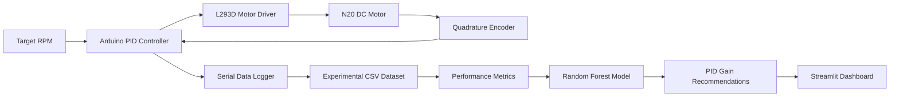

# AI-Assisted PID Motor Speed Control

**Data-driven PID gain recommendation for a DC geared motor using Arduino, encoder feedback, and Random Forest regression.**

[](https://peezpeke-ai-pid.streamlit.app)


> **Live app:** [AI-PID Motor Dashboard](https://peezpeke-ai-pid.streamlit.app)  
> **Status:** Offline AI model trained and evaluated; live AI-selected motor control has not yet been independently validated.

## Overview

This college project investigates **closed-loop speed control of a DC geared motor** and uses machine learning to recommend proportional–integral–derivative (PID) gains based on experimental performance. An Arduino reads motor encoder pulses, estimates rotational speed, and adjusts PWM output through a motor driver. Python collects experimental measurements, computes controller-performance metrics, and trains a **Random Forest regressor** to estimate a performance score for candidate PID settings.

An interactive **Streamlit dashboard** presents the tested operating points, AI-recommended gains, and validation results.

## Hardware

| Component | Role |
| --- | --- |
| Arduino Uno (CH340 USB-serial variant) | Encoder sampling and PID control |
| N20 geared DC motor, nominal 3 V / 150 RPM, with encoder | Controlled plant and speed feedback |
| HW-130 L293D motor shield (V1) | PWM motor drive |
| USB connection | Arduino communication and power during repeatability tests |
| External supply and LM2596 buck converter | Used in earlier experimental setup; supply conditions differed across datasets |
| PC with Python | Data logging, analysis, AI training, and dashboard |

**Encoder calibration:** approximately **370.8 counted rising-edge pulses per output-shaft revolution** for the chosen counting method. Speed was sampled approximately every **200 ms** during **30-second** tests.

**Hardware caution:** The L293D motor-driver voltage drop and supply requirements make it an imperfect match for a nominal 3 V motor. The original and USB-powered repeatability datasets were collected under different power conditions and are analyzed separately where appropriate. Do not assume that motor-terminal voltage equals the nominal supply voltage.

## System workflow



The AI is currently an **offline gain recommender**. The diagram does not imply that the model continuously adjusts the controller during motor operation.

## Experimental dataset

| Dataset | Experiments | Notes |
| --- | ---: | --- |
| Initial PID trials | 24 | Multiple gain combinations at 40, 50, and 60 RPM |
| Repeatability trials | 18 | Three repeats per speed and gain setting; motor powered through USB-connected setup |
| **Total** | **42** | **Separate supply-condition labels retained** |

The repeatability experiments tested **40, 50, and 60 RPM**, with **Kp = 1.0 or 1.5**, **Ki = 0.7**, and **Kd = 0**. Each repeatability recording contains **149 samples**, for **2,682 samples** across the 18 repeats.

## Machine-learning approach

1. Collect time-series data including target RPM, measured RPM, PWM, PID error, and gains.
2. Calculate run-level PID performance measures and a composite performance **score** (lower is better).
3. Train a **Random Forest regression model** to estimate the performance score for candidate gain settings.
4. Evaluate predictions using cross-validation over complete experimental runs and compare against a simple baseline.
5. Rank candidate gains by predicted score for each tested target speed and experimental condition.

**Evaluation limitation:** Although validation separates complete runs, some PID gain combinations appear in both training and validation folds. Results therefore do **not** establish generalization to previously untested gains, different motors, or new power-supply configurations.

## Results

### Cross-validated score prediction

| Metric | Random Forest AI | Baseline |
| --- | ---: | ---: |
| Mean absolute error (MAE) | **1.656** | 1.896 |
| Root mean squared error (RMSE) | **2.392** | 2.412 |
| R² | **−0.032** | −0.049 |

**MAE reduction relative to baseline: 12.64%.** This is an improvement in **performance-score prediction**, **not** a 12.64% reduction in actual motor speed error. The slightly negative R² indicates that predictive strength remains limited.

### Predicted best PID gains

| Experimental condition | Target RPM | Kp | Ki | Kd |
| --- | ---: | ---: | ---: | ---: |
| Original | 40 | 1.5 | 0.7 | 0 |
| Original | 50 | 1.0 | 0.7 | 0 |
| Original | 60 | 1.5 | 0.7 | 0 |
| USB-powered repeats | 40 | 1.5 | 0.7 | 0 |
| USB-powered repeats | 50 | 1.5 | 0.7 | 0 |
| USB-powered repeats | 60 | 1.5 | 0.7 | 0 |

These are **offline model recommendations**, not results from independent motor tests using AI-selected gains.

## Live dashboard

**[Open the AI-PID Streamlit Dashboard](https://peezpeke-ai-pid.streamlit.app)**

The dashboard presents target-speed selections, recommended PID gains, model-predicted performance scores, and experimental/validation visualizations.

> Replace the URL above if your actual Streamlit deployment uses a different app address.

## Run locally

Clone the repository:

```bash
git clone https://github.com/peezpeke/AI-PID-Motor-Dashboard.git
cd AI-PID-Motor-Dashboard
```

Install dependencies:

```bash
python -m pip install -r requirements.txt
```

Launch the dashboard:

```bash
python -m streamlit run ai_pid_dashboard.py
```

Open the local URL printed by Streamlit (typically `http://localhost:8501`).

### Files used by the deployed dashboard

```text
AI-PID-Motor-Dashboard/
├── ai_pid_dashboard.py
├── ai_pid_42_model.joblib
├── ai_pid_42_gain_rankings.csv
├── ai_42_run_metrics.csv
├── ai_42_validation.csv
├── ai_42_accuracy_summary.csv
├── requirements.txt
└── README.md
```

Some dashboard versions may only load a subset of the listed files. The raw motor logs are not required to run the deployed dashboard if the summarized data files are already present.

## Key takeaways

- Implemented encoder-feedback PID speed control on a physical DC motor.
- Collected **42 experiments** at three target speeds.
- Trained and cross-validated a **Random Forest** model for PID performance-score prediction.
- Achieved **12.64% lower prediction MAE** than a simple baseline on the available cross-validation setup.
- Deployed an interactive web dashboard for exploring recommendations and results.

## Limitations and future work

- Small dataset and a limited set of PID gain combinations; all reported tests used **Kd = 0**.
- Different motor-power arrangements across experiment groups.
- Negative cross-validated R² despite improved MAE.
- No independent demonstration yet that AI-selected gains improve live motor control relative to a fixed-gain PID controller.
- Future extensions: consistent regulated motor power, additional gains and target speeds, stronger holdout validation, and supervised live AI-selected gain tests.

## Project scope

**Educational / college project.** This is a proof of concept for **AI-assisted PID tuning**, not a production-ready adaptive controller or a safety-rated motor control system.
